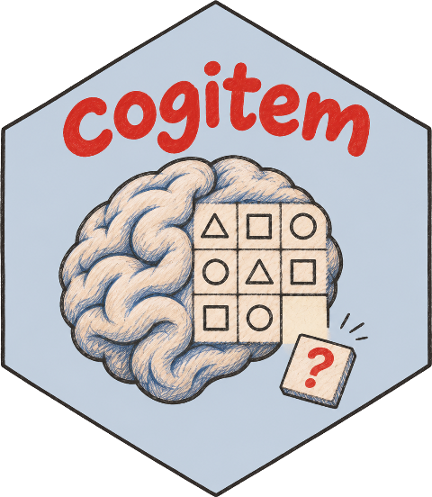

# cogitem 

Rule-based automatic generation of Raven-like 3x3 matrix items in R.

`cogitem` builds figural matrix items from an explicit item model (a figural
carrier crossed with a relational rule), checks that the response options of
every item are distinct (symmetry-aware symbolic signatures and explicit
design constraints; an experimental image-similarity screen is optional),
records the design features of every
item for explanatory item response models, draws items with `grid`, and ships
a Shiny application for computerised administration.

## Installation

```r
# install.packages("remotes")
remotes::install_github("cahitgs/cogitem@v0.1.4")   # release described in the paper
remotes::install_github("cahitgs/cogitem")           # development version
```

## Quick start

```r
library(cogitem)

items <- generate_items("dice", "addition", n = 20, seed = 42)
items
#> <cog_item_set> 20 item(s) | dice x addition | seed 42

plot(items[[1]], show_answer = TRUE)

# design features (Q-matrix input) ------------------------------------
head(item_features(items))
Q <- q_matrix(items, ~ rule + shape)

# a test that samples every rule available for one carrier ----------
specs <- subset(supported_combinations(), shape == "sector-pie")
test <- generate_mixed(specs, n_each = 3, seed = 1)
save_booklet(test, "sector-pie-test.pdf")

# keep the item bank for later sessions --------------------------------
saveRDS(test, "sector-pie-test.rds")

# computerised administration -----------------------------------------
run_app(test)
```

## The item model

Every item is one **shape family** crossed with one **rule**. The rules
correspond to the relational taxonomy of Carpenter, Just and Shell (1990) for
the Raven Progressive Matrices, extended with bitwise logic.

| Rule | Family | Carriers |
| --- | --- | --- |
| `identity` | constant in a row | all 15 shapes |
| `dist-of-3` | distribution of three values | all 15 shapes |
| `dist-of-2` | distribution of two values + blank | 12 shapes (not grid dots, checkerboard, block letter: they have sparse or empty states) |
| `progression` | quantitative pairwise progression on two axes | 14 shapes |
| `addition`, `subtraction` | figure addition / subtraction on a count | 7 count-based shapes |
| `multiplication` | figure multiplication | `dice`, `sector-pie` |
| `rotation` | sliding-window rotation | `arrow`, `hammer` |
| `mirror` | 180-degree flip of a row or column | `arrow`, `hammer` |
| `and`, `or`, `xor`, `xnor` | bitwise logic on a presence mask | `sector-pie`, `checkerboard` |

Shape families: annulus, dice, polygon, star, arrow, petals, spike ring,
hammer, bars, grid dots, checkerboard, box lines, nested polygon, sector pie,
block letter. `supported_combinations()` lists the 60+ admissible pairs.

### Option uniqueness

Each response option is compared with every other option through
`visual_signature()`, which normalises rotation by the shape's rotational
symmetry; a second set of design constraints rejects count, size,
stroke-width, rotation and colour steps that are too small (15 versus 16
spikes, a size step under 0.10 of the cell). These constraints were set by
inspecting rendered examples at cell size, not validated with observers.
Distractors are drawn first from rule-derived candidates (the other
distribution variants, grid neighbours, operands, wrong operators, bit flips)
and then from an ordered pool of perturbations (count, colour, size, fill,
rotation, stroke width). Items that fail `is_item_valid()` are discarded and
regenerated.

### Image-similarity screen (experimental)

The symbolic check cannot see that two hand-made configurations which differ
only in a tiny size step render almost identically. `audit_items()` therefore
rasterises every option and every nominally different cell pair at 96 px,
blurs the CIELAB images slightly and computes a distance in `[0, 1]` (0 =
identical, about 1 = no overlapping ink); items whose smallest distance falls
below 0.15 are flagged. The screen is a fixed-resolution development tool: it
has not been validated against human observers, it is off by default for
every item type, and `generate_items(perceptual = TRUE)` switches it on during
generation.

```r
audit_items(items)
clean <- generate_items("sector-pie", "xor", n = 50, seed = 1, perceptual = TRUE)
```

### Design features

`item_features()` returns, for every item, the rule and its family, the
carrier, the number of options, how the distractors were constructed, and
rule-specific parameters (varying axis, progression axes, rotation step,
operands, bit count). `q_matrix()` turns these into a design matrix for
linear logistic test models (`eRm::LLTM()`), explanatory IRT models
(`lme4::glmer()`, `TAM`) or any other analysis that links design features to
empirical item difficulty. The package assigns no a priori difficulty rating
on purpose: difficulty is to be estimated from response data.

## Two-layer items

`generate_layered()` superimposes two independently generated matrices cell
by cell, as `com()` does in matRiks: an outer carrier (`polygon` or
`spike-ring`, drawn large with a free centre) and an inner carrier drawn on a
small disc in the middle, each following its own rule. Solving the item
requires both rules, the classic "number of rules" manipulation of
matrix-item difficulty (Carpenter, Just & Shell, 1990). Every distractor is
wrong in the inner layer, in the outer layer or in both, and the design
features record which (`distractor_tiers`, `outer_rule`, `inner_rule`,
`n_layers`). Any option count from 2 to 8 works: each layer is generated
with at most four options and the distractors are drawn from the
combinations of the layers' wrong options, the inner layer being judged at
the scale it is drawn (36 % of the cell). Both layers are pinned to one size
and size never carries a rule or a distractor in a two-layer item; the dots
and markers of the inner layer are drawn 1.5 times larger than pure scaling.
Outer carriers that would leave less room, a triangle or a deep spike ring,
are rejected, so the polygon outer layer offers identity, distribution of
three and progression (`layer_rules("polygon", "outer")`), and carriers whose
progression needs a size axis (dice, arrow, hammer, grid-dots, checkerboard,
block-letter, box-lines) or whose rings become hairlines at the inner scale
(annulus) have no progression inside a layer
(`layer_rules("dice", "inner")`). Items are designed for cells of at least
144 px on screen; the image-similarity screen is off by default for two-layer
items too.

```r
items <- generate_layered(outer = c("polygon", "progression"),
                          inner = c("dice", "dist-of-3"), n = 10, seed = 1)
plot(items[[1]], show_answer = TRUE)
layer_shapes("inner")
layer_rules("dice")
```

## Shiny application

`run_app()` opens an application with four panels: **Generate** (shape,
rule, optional inner layer, n, seed, option count; items shown one at a time with Previous/Next or the arrow keys; item-set `.rds`, feature-CSV,
screen-CSV and PDF booklet downloads), **Browse** (single items with answer key and design
features), **Administer** (one item at a time, answered by click or number
key, logging the chosen option, response time and the hover trace of every
option, with a results summary and CSV export) and **About**. The interface
ships its own typefaces (Fraunces and Manrope, SIL Open Font License) and
needs no internet connection. With **callr** installed, generation runs in a background R
process with a progress bar and a *Stop* button that keeps the items produced
so far.

## License

MIT. Copyright (c) 2026 Mehmet Cahit Marangoz.
